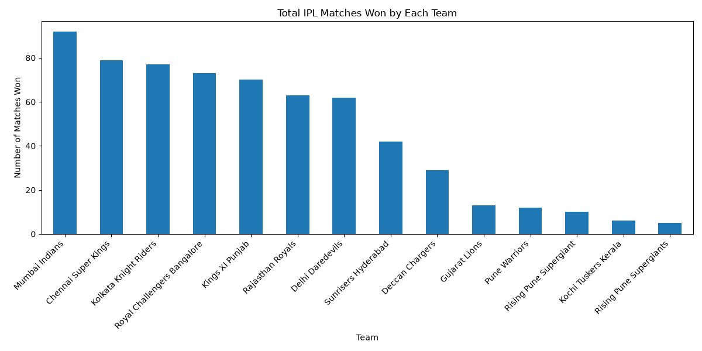
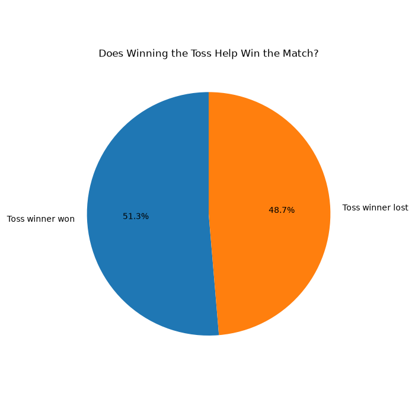
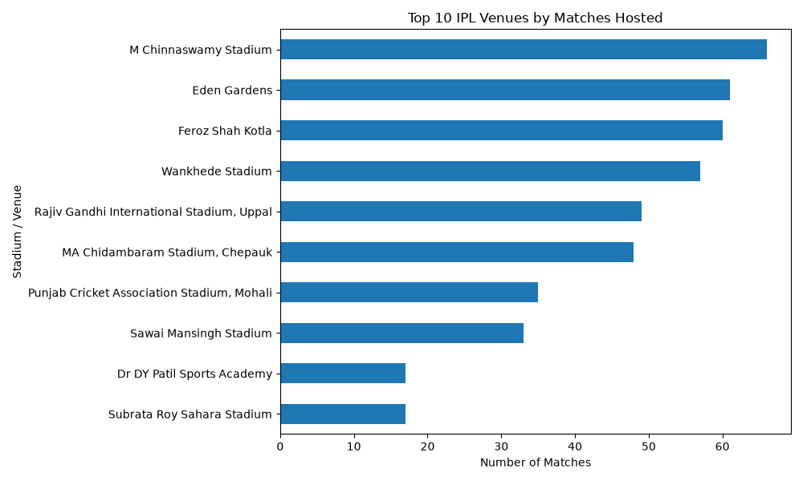
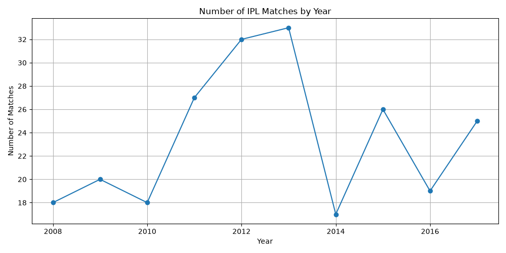
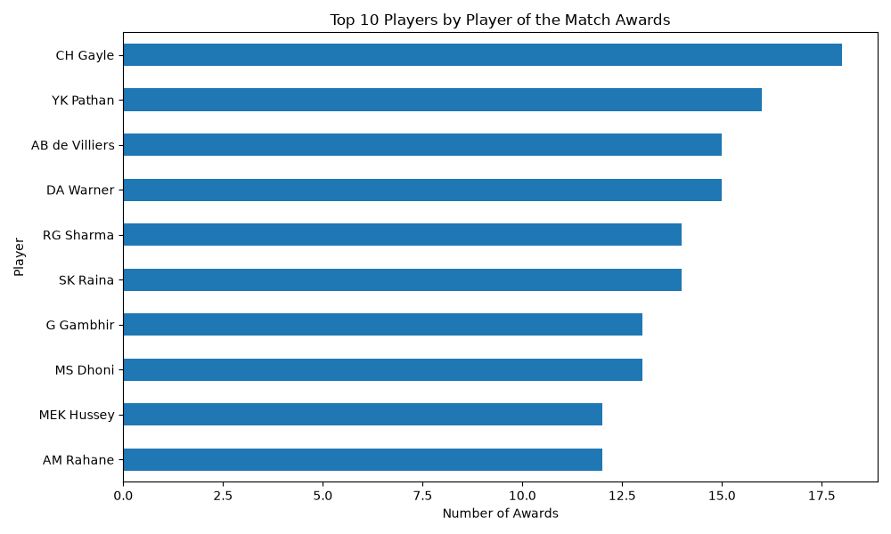

# IPL Data Analysis Project

## Overview
An exploratory data analysis project using IPL match data
to understand team performance, toss outcomes, venues,
seasonal trends and player awards.

## Tools Used
- Python
- Pandas
- NumPy
- Matplotlib
- VS Code

## Questions Answered
1. Which team has the most match wins?
2. Does winning the toss help win the match?
3. Which venues host the most matches?
4. How does the number of matches change by year?
5. Which players receive the most Player of the Match awards?

## Key Findings
- Team with the most wins: Mumbai Indians
- Toss winner also won: 51.3% of analyzed matches
- Most frequently used venue: M Chinnaswamy Stadium
- Top player by awards: CH Gayle (18 awards)

## Project Files
- `ipl_analysis.py` - Python analysis code
- `matches.csv` - Original dataset
- `cleaned_matches.csv` - Cleaned dataset
- `team_wins.png` - Team wins visualization
- `toss_analysis.png` - Toss outcome visualization
- `top_venues.png` - Venue visualization
- `matches_by_year.png` - Yearly match visualization
- `top_players.png` - Player awards visualization

## How to Run
Install the required libraries:

`python -m pip install pandas numpy matplotlib`

Run the project from the parent folder:

`python IPL-Data-Analysis/ipl_analysis.py`

## Data Visualizations

### 1. Total Matches Won by Each Team

### 2. Does Winning the Toss Help Win the Match?

### 3. Top 10 IPL Venues by Matches Hosted

### 4. Number of IPL Matches by Year

### 5. Top 10 Players by Player of the Match Awards

## Data Cleaning

- Inspected the dataset using Pandas `info()` and `isnull().sum()`.
- Identified missing values in city, winner, Player of the Match, and umpire columns.
- Checked for duplicate records.
- Converted the date column to datetime format for year-wise analysis.
- Created a year column to analyze the number of matches by season.

**Note:** Missing values were inspected before deciding how to handle them. The original dataset contains 636 match records.